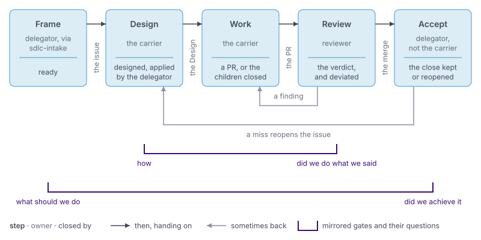

> Every organization on the Initiative / Epic / Task / Bug ladder shares one lifecycle; its `sdlc-mapping.md` binds it ([mapping](references/mapping.human.md)).

Fires: setting up issues, writing a mapping, asking how status works, reporting up, handing off to a fresh session. Setup runs first.

Backlog → Ready → In progress → In review → Done (↘ Blocked, Dropped)

## The ladder

|Jira|GitHub|Size|
|---|---|---|
|Initiative|`type: Initiative`|one outcome; its own Epics, ≥ 2 preferred|
|Epic|`type: Epic`|weeks|
|Story / Task|`type: Task`|days, one PR|
|Spike|Task titled `Spike: …`|a decision|
|Bug|`type: Bug`|as a Task|
|Release|`type: Release`|one version of one repo|
|Cross-project release|`type: Rollout`|Releases across repos|
|Sub-task|·|a Task wanting children is an Epic|


## Mechanisms

|Mechanism|Carries|
|---|---|
|Dependency|`blocked by`; a Release or Rollout read by title and state only|
|Release|blocked by an Epic, or a Task where its Epic ships apart; versions fixed and appended, so work moves later; renumbering rare, its cost weighed; an Initiative mentions its Rollouts, never blocked by one|
|Label|`ready`, `designed`, `deviated`|
|Board|status and Priority, projected|
|Priority|set on Initiatives; blank inherits|

`blocked by` means can't start; a wait to finish is checked at the close, never linked.

## Status

`sdlc-status.mts OWNER/N --mapping PATH [--apply] [--reset]` derives it.

|Status|Holds when|
|---|---|
|Backlog|open|
|Blocked|an open `blocked by`|
|Ready|`ready`, unassigned, unblocked, fields filled|
|In progress|assigned|
|In review|an open PR closes it|
|Done|closed **completed**|
|Dropped|closed **not planned**|

Work starts on a Ready Task or Bug, highest Priority first.

## Roles

|Role|Takes|
|---|---|
|`delegator`|what the delegate cannot own; default, whoever handed over the work|
|`reviewer`|a PR's review; default `CODEOWNERS`|

A delegate ⛔ escalates a choice it cannot own; a **remit** hands choices down short of its **stops**: by default a person's fact, canon, policy, a message to others, a decided choice, closing an Initiative. `designed` comes from the delegator, never the Design's author. An agent acts on a Task or Bug, ⛔ on an Epic or Initiative; assigning and editing another's issue ⛔.

## Handoff

A fresh session starts from one: Goal, linked · Decided, do not reopen · Grants, quoted · Stop · Environment.

## Reporting

Each item goes up once, when it arises or changes; nothing unchanged repeats, and a notice that changes nothing gets no line. A status outline only when asked, or when all waits on the person: their queue first, by what it unblocks; product, not process. Shape: [`human-output`](../human-output/SKILL.human.md).

## Stages

A stage runs its checks and posts one comment:

```markdown
### <skill> · <Stage>: pass|escalate|stop
```

|Ends in|Then|
|---|---|
|pass|proceed|
|escalate|the `delegator` takes it|
|stop|the same climb|

## Phases




**Frame**: the delegator applies `ready` once the body meets its type, parent, repository, form, bar and problem first; `designed` too when it settles every choice short of a stop.

**Accept**: the delegator checks a closed issue against its frame, never its diff; a miss reopens it. It follows the close, but an Initiative's, and any a stop names, wait on it.

## Closing

|Outcome|Close|
|---|---|
|Done as planned|**completed**|
|Done differently|**completed** + `deviated` from the review, ⛔|
|Not planned|**not planned**, ⛔|

The issue holds the problem, its Design the solution: a Design settling what the body left open is not `deviated`; contradicting the body, or settling a stop, is.

## Linking an issue to its branch and PR

`Closes #N` in the PR body; `gh issue develop N --name <branch>` before the push.

## Setup

Once per repository: `sdlc-setup.sh OWNER/REPO`; act on each `TODO`.

Add a missing column in the board's settings; replacing Status options through the API clears every card's Status, which `--apply` restores.
